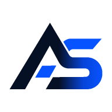
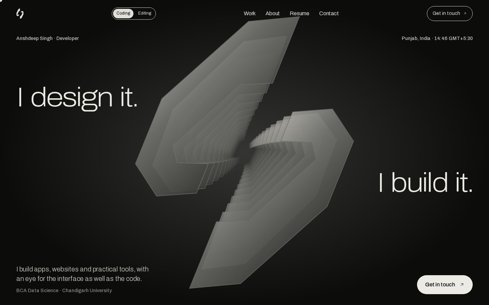
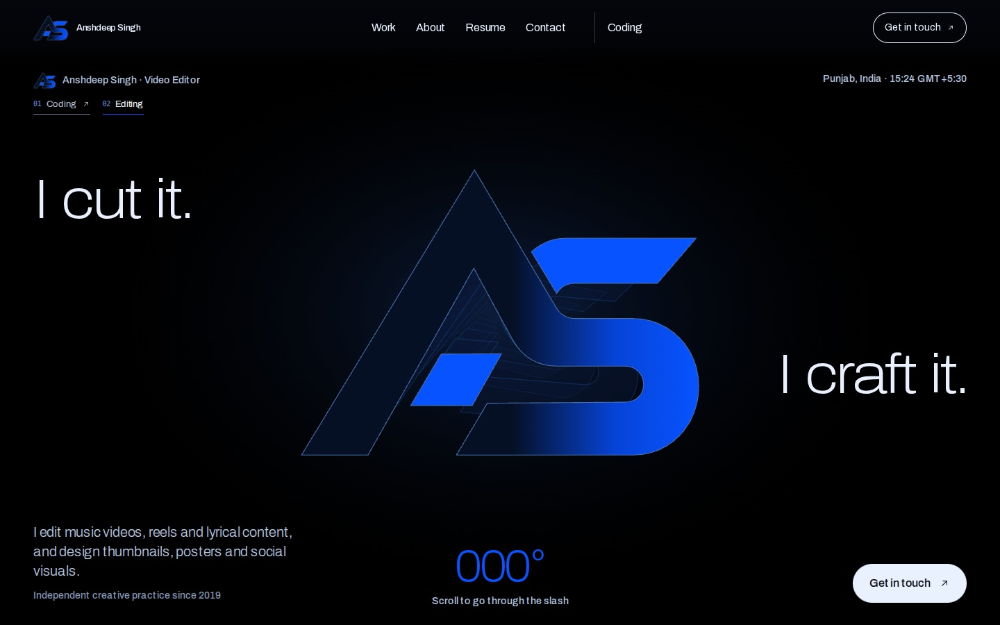

  
  <h1>Anshdeep Singh</h1>
  
<strong>DEVELOPER &nbsp; / &nbsp; VIDEO EDITOR &nbsp; / &nbsp; DIGITAL CREATOR</strong>

  
Two disciplines. One identity. Built with purpose.

  
  

  
  
  

---

## One portfolio. Two perspectives.

I build applications, websites and software tools, and create visual stories through video editing and graphic design. My portfolio brings together a shared black-and-blue AS identity, two distinct experiences, and a collection of my work.

<table>
<tr><td width="50%" align="center"><strong>01 — Coding</strong> Apps, web development, systems and software.</td><td width="50%" align="center"><strong>02 — Editing</strong> Video editing, motion and graphic design.</td></tr>
</table>

## Featured projects

| Project | Focus | Explore |
| :--- | :--- | :--- |
| **AniDash** | Anime discovery and web experience | [Website](https://anidashgo.vercel.app/) |
| **VYBE** | Android music player | [Download](https://vybetune.vercel.app/download.html) |
| **ZYLO** | Android media application | [Website](https://zylod.vercel.app/home) |
| **CopyCloud** | Cross-device file and text transfer | [Website](https://copycloud.me/) |
| **SocialBoost** | Creator analytics and social tools | [Website](https://socialboostweb.vercel.app/) |

[Explore all 24 projects →](https://anshdeepofficial1.vercel.app/work)

## Skills & education

- **Coding:** React, Next.js, TypeScript, Flutter, Dart, Python, SQL and Rust.
- **Editing:** video editing, lyrical videos, reels, motion design, graphics and typography.
- **Education:** BCA (Hons. with Research), Data Science — Chandigarh University.

## Resumes

| Profile | Online preview | Original PDF |
| :--- | :--- | :--- |
| Coding | [View resume](https://anshdeepofficial1.vercel.app/resume/coding) | [Download PDF](public/resumes/resume_coding.pdf) |
| Editing | [View resume](https://anshdeepofficial1.vercel.app/editing/resume) | [Download PDF](public/resumes/resume_editing.pdf) |

## Explore my portfolio

  <a href="https://anshdeepofficial1.vercel.app/coding"><strong>Explore Coding</strong></a> &nbsp;·&nbsp; <a href="https://anshdeepofficial1.vercel.app/editing"><strong>Explore Editing</strong></a> &nbsp;·&nbsp; <a href="https://anshdeepofficial1.vercel.app/work"><strong>All Projects</strong></a>

## Contact

**Coding:** [anshdeepofficial1@gmail.com](mailto:anshdeepofficial1@gmail.com)  
**Editing:** [anshdeep200618@gmail.com](mailto:anshdeep200618@gmail.com)  
**Location:** Punjab, India

[Contact page](https://anshdeepofficial1.vercel.app/contact) · [GitHub](https://github.com/anshdeepofficial1) · [LinkedIn](https://www.linkedin.com/in/anshdeepofficial1/) · [Instagram](https://www.instagram.com/anshdeepofficial1/)

---

  
  
<strong>Anshdeep Singh</strong> Personal content and branding reserved. Software license: <a href="LICENSE">MIT</a>.

